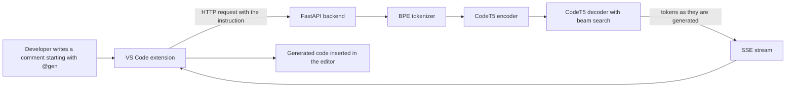

# NL-to-Code Generator

**Turn plain-English instructions into code without leaving your editor.**

A transformer-based natural-language-to-code system built on **Salesforce CodeT5**, served through a **FastAPI** backend and used from inside **VS Code** through a custom extension. Type a comment with the `@gen` trigger, and generated code streams back into your editor token by token.

    

---

## Highlights

- **Encoder-decoder transformer:** uses `Salesforce/CodeT5-base`, a pretrained model for code understanding and generation.
- **Beam-search decoding** for more coherent generated code than greedy decoding.
- **Streaming responses over Server-Sent Events (SSE):** output appears in the editor as it is generated instead of after a long wait.
- **Editor-native workflow:** a VS Code extension triggered by an `@gen` prefix, so there is no copy-pasting between a browser and your code.
- **Clean separation of concerns:** model inference, API layer and editor client are independent components.
- **Documented design:** includes an architecture diagram and a written technical report covering system design, data flow and technology stack.

---

## How it works



1. The developer writes an instruction in a comment using the `@gen` trigger prefix.
2. The VS Code extension detects the trigger and sends the instruction to the backend.
3. The FastAPI service tokenizes the text with **BPE (byte-pair encoding)** and passes it to the **CodeT5 encoder-decoder**.
4. The decoder generates code using **beam search**.
5. Tokens are streamed back over **SSE** and inserted into the editor as they arrive.

---

## Tech stack

| Layer | Technology |
|---|---|
| Model | Salesforce CodeT5-base (encoder-decoder transformer) |
| Tokenization | BPE (byte-pair encoding) |
| Decoding | Beam search |
| Backend | Python, FastAPI |
| Streaming | Server-Sent Events (SSE) |
| Frontend | VS Code extension (TypeScript/JavaScript) |

---

## Getting started

> Adjust the paths below to match your repository layout.

### Prerequisites

- Python 3.9+
- Node.js and npm (to build the VS Code extension)
- VS Code
- A GPU is optional and speeds up inference. The model also runs on CPU.

### 1. Start the backend

```bash
git clone https://github.com/Gunika19/<repo-name>.git
cd <repo-name>/backend
python -m venv .venv && source .venv/bin/activate
pip install -r requirements.txt
uvicorn main:app --reload
```

### 2. Install the extension

```bash
cd ../extension
npm install
npm run compile
```

Open the `extension` folder in VS Code and press `F5` to launch an Extension Development Host.

### 3. Generate code

In any file, write an instruction using the trigger prefix, for example:

```python
# @gen function that returns the n-th Fibonacci number
```

The generated code streams into the editor.

---

## Project structure

```
<repo-name>/
├── backend/        # FastAPI service and CodeT5 inference
├── extension/      # VS Code extension (@gen trigger, SSE client)
├── docs/           # Architecture diagram (SVG) and technical report
└── README.md
```

---

## Documentation

- **Architecture diagram (SVG):** `docs/` shows the end-to-end system and data flow.
- **Technical report:** `docs/` covers system design, data flow and technology choices in detail.

---

## Evaluation

> Fill this section with real measurements only.

| Metric | Value |
|---|---|
| Model / checkpoint | _to be filled_ |
| Dataset / test prompts | _to be filled_ |
| Evaluation metric (for example BLEU, CodeBLEU or pass@k) | _to be filled_ |
| Average response latency | _to be filled_ |

---

## Limitations

- Generated code is a suggestion. It can be incorrect or insecure, so review and test it before use.
- Output quality depends on the model checkpoint and on how clearly the instruction is written.
- Inference speed depends on available hardware.

---

## Future work

- Fine-tuning on a domain-specific dataset
- Support for more programming languages
- Automatic test generation for the produced code
- Latency optimisations such as quantisation or batching

---

## Author

**Gunika Sohal** · B.E. Electrical and Computer Engineering, Thapar Institute of Engineering and Technology

[GitHub](https://github.com/Gunika19) · [LinkedIn](https://www.linkedin.com/in/gunika-sohal-bb5935289)
